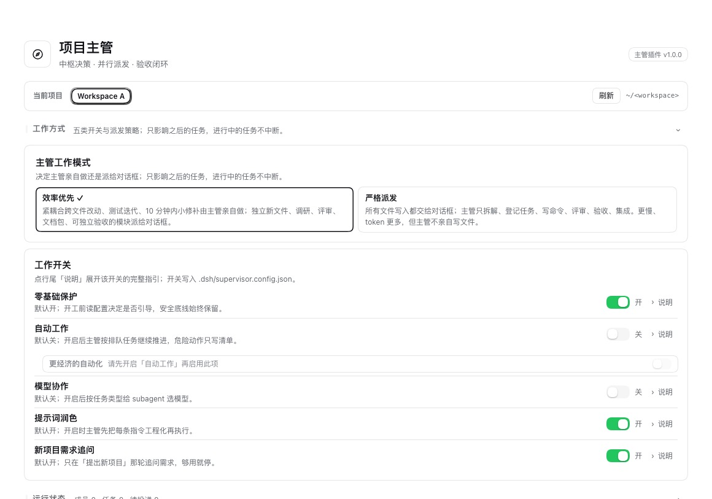
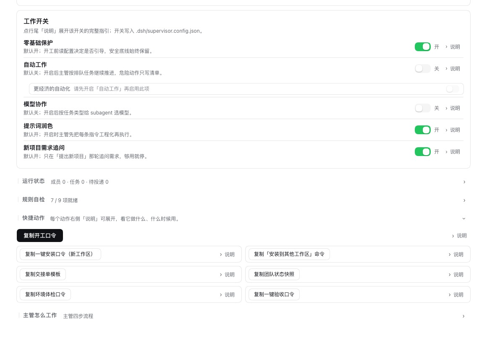

# dsh-project-supervisor · DSH「项目主管」

[](LICENSE)
[](#状态--status)
[](https://github.com/awesome-dsh-plugin/awesome-dsh-plugin)
[](https://github.com/awesome-dsh-plugin/awesome-dsh-plugin/blob/main/data/plugins/Midnight-1991__dsh-project-supervisor.yml)

**把 DSH 变成项目主管**：常驻作业规则 + 并行对话框调度 + Web「主管」面板。
**A project supervisor for DeepSeek Harness**: standing rules, parallel teammate dialogs, and a supervisor panel.



> 截图为脱敏版：工作区名/路径已替换为占位符。 / Screenshots are redacted.

## 它是什么 / What it is

- **常驻规则包**：把 `AGENTS.md`、两个技能（项目主管、提示词润色）和《主管手册》装进任意工作区——开会话就自动以「主管」方式工作：拆目标、登记任务板、用 Agent Teams 并行打开对话框架、验收产物。
- **Web「主管」面板**（本仓库根目录即 DSH 插件包）：单列滚动页 = 顶部当前项目条 + 四分区（工作方式 / 运行状态 / 规则自检 / 快捷动作）+ 使用说明；四个分区与「使用说明」可折叠——默认只展开工作方式与快捷动作，其余收起为一行灰色摘要（偏好存 `localStorage`）；工作方式区两张全宽卡（主管工作模式 + 5 行「工作开关」清单，行尾「说明」可在行内展开完整指引）；工程底线自检、主管工作流、7 个快捷口令、五个可持久化开关（零基础保护 / 提示词润色 / 新项目需求追问 / 自动工作 / 模型协作）与工作模式选择（效率优先 / 严格派发）；「自动工作」行内另有缩进次级开关「更经济的自动化」（默认关，仅在 DeepSeek 谷价时段推进自动工作）。
- **自动工作（无人值守，默认关）**：面板「自动工作」开关打开后，主管离开电脑时按 `.dsh/auto-work-queue.md`（排队任务 / 阻塞 / 待回答的问题 / 自动工作日志 / 经济模式状态）继续推进可完成项；不弹窗提问、不请求授权，不可逆动作只记阻塞，停止时写日志并给总结。只读排队消息脚本随技能分发（`skill/scripts/peek-mailbox.mjs`）。可选「更经济的自动化」次级开关（默认关）：只在 DeepSeek 谷价时段（北京时间工作日 09:00–12:00、14:00–18:00 之外 + 周末/节假日全天）推进自动工作——高峰前 20 分钟起收尾、高峰开始后 ≤10 分钟到检查点暂停、谷价开始后自动续跑，状态写入队列「经济模式状态」节；仅约束自动工作，手动使用不受影响。
- **环境体检与一键验收**：随套件的 `supervisor-doctor.sh`（`--with-setup` 时装进 `<工作区>/setup/`）只读体检（运行时/工作区预算/套件/插件/残留；PASS/WARN/FAIL + `--json`）；`supervisor-verify.sh` 一键验收（doctor→镜像→事实/预算→插件三测→脚本自测→可选补丁→安装包回归→git 卫生/密钥扫描，`--fast` 跳过慢回归）；第 7 个技能模板 `templates/handoff.md` 是交接单（上下文风险/换对话框时用）。
- **团队复用（名册/账本）**：派发前先查 `.dsh/team-roster.md` 与 `.dsh/team-ledger.md`，优先唤醒 inactive 对话框（warm-start 简报），只有角色缺失/写范围冲突/需 fresh 才新建；名册与账本模板随安装器播种。
- **模型协作（默认关，面板可开）**：两种模式——AI 自动选择（可编辑 6 行路由表）/ 用户手动选择；仅对 subagent 生效（teammate 不能选模型），命令写明模型、不支持的回落。
- **分享包内容**（`kit/`）：一条命令把主管装进任意工作区（macOS/Linux/Windows）；含模板、调研报告、工程化脚本（`kit/` 内的 sync-kit/selftest/verify-facts/build-dist）与可选权限补丁；`--with-setup` 可把脚本一并装进目标工作区。
- **可选权限补丁**：给单个对话框按风险传沙箱范围（`read-only` / `workspace-write` / `danger-full-access`）与只读工具白名单。
- **自动工作的两个可选补丁**（纯可选、需手动安装）：`patches/auto-work-timed-ask`（把提问改成限时等待）、`patches/auto-work-permission`（「自动工作」权限预设）；未应用时上述自动工作规则仍按默认安全边界生效。

## 快速开始 / Quick start

### 1) 安装 DSH Web 面板（本仓库即插件包）

可在 DSH 插件市场（插件 → 发现）搜索 *项目主管*，或直接从 GitHub 安装（v1.0.0 正式版）：

```bash
dsh plugin --profile web add github:Midnight-1991/dsh-project-supervisor
# 然后重启 dsh web，并在侧栏打开「主管」
```

本地开发也可以 `link:` 安装本仓库：`dsh plugin --profile web add link:/path/to/dsh-project-supervisor`（详见 `kit/安装说明.md` 与插件 `README.md`）。

> 插件安装需要 `pnpm` 在 PATH（`dsh plugin` 会把参数转发给 pnpm）。

### 2) 给某个工作区建立主管规则（可选，但推荐）

两种来源，命令不同（**注意目录层级**）：

**A. 从本仓库（未解压，`kit/` 目录）**

```bash
# macOS / Linux
bash kit/install-supervisor.sh /path/to/your-workspace --with-research --with-setup

# Windows（PowerShell / CMD）
node kit/install-supervisor.mjs C:\path\to\your-workspace --with-research --with-setup
```

**B. 从 [Releases](https://github.com/Midnight-1991/dsh-project-supervisor/releases) 下载 zip（解压后，包根目录没有 `kit/`）**

```bash
unzip project-supervisor-kit-*.zip
cd project-supervisor-kit-*

# macOS / Linux
bash install-supervisor.sh /path/to/your-workspace --with-research --with-setup

# Windows（PowerShell / CMD）
node install-supervisor.mjs C:\path\to\your-workspace --with-research --with-setup
```

两条路线装出的内容相同；zip 路线的插件安装是 `cd plugin/dsh-project-supervisor`，仓库路线是 `cd kit/plugin/dsh-project-supervisor`。

装完用 DSH 打开该工作区、新建会话（cwd 必须是该目录），直接说目标即可。

### 3) 试试

> 帮我做一个记账小工具

主管会先追问关键需求（可在面板关掉），再给 MVP、拆任务、按需并行开对话框、验收后汇报。

## 面板里有什么 / Panel



> 面板截图（v1.0.0 版式）：`panel.jpg` 默认折叠态总览 / `panel-middle.jpg` 面板中部 / `panel-bottom.jpg` 下半部分 / `panel-mode-strict.jpg` 严格派发 / `panel-interview-off.jpg` 需求追问关闭；均为脱敏版。

| 区域 | 说明 |
|---|---|
| 当前项目条 | 顶部：按会话 cwd 去重的工作区 chips（默认最近一个，可切换）+ 小号「刷新」按钮 + 当前路径（保留项目名的中间省略显示） |
| 工作方式（两张全宽卡） | ①「主管工作模式」：效率优先 / 严格派发 二选一，写入 `.dsh/supervisor.config.json` 的 `dispatchMode`；②「工作开关」清单卡：零基础保护 → 自动工作 → 模型协作 → 提示词润色 → 新项目需求追问 5 行，每行名称 + 说明 + 右侧开关 + 行尾「说明」展开完整指引（默认收起、折叠偏好存 localStorage；模型协作开启时自动展开 auto/manual 两选项与 6 行路由表）；「自动工作」行内还有缩进次级开关「更经济的自动化」（默认关、自动工作关闭时置灰） |
| 分区折叠 | 工作方式 / 运行状态 / 规则自检 / 快捷动作 / 使用说明各有标题行折叠按钮（`aria-expanded`/`aria-controls`）；默认只展开工作方式与快捷动作，其余收起为一行摘要（成员 / 任务 / 待投递、`n / 9 项就绪`、`7 个快捷动作`、主管四步流程）；偏好存 `psup.zone.<zone>`，与行级「说明」折叠互不影响 |
| 运行状态 | 团队与任务只读卡：成员 / 任务 / 待投递计数，随顶部「刷新」一起更新（卡内不再放重复刷新按钮）；host 未重启时降级提示 |
| 规则自检 | `x / 9` 工程底线自检：`.git`、`README.md`、`.gitignore`、`DECISIONS.md`、`AGENTS.md`、`.env.example`、`research/`、`setup/`、`.dsh/skills` 9 项网格；进度条 + 缺失建议列在网格下方 |
| 快捷动作 | 1 个主按钮「复制开工口令」（宽度随内容）+ 6 个 2 列次动作（一键安装口令、安装到其他工作区命令、交接单模板、团队状态快照、环境体检口令、一键验收口令）；每个右侧「说明」可展开；复制失败弹「手动复制」只读文本层 |
| 使用说明 | 主管四步工作流（带分区标题）+ 两行页脚 |

严格派发模式下：任何文件写入都交给对话框，主管只拆解、评审、验收、集成。

## 兼容性 / Compatibility

- macOS：完整实测（DSH `0.2.0-rc.2`，Chrome/Web GUI）。
- Windows：安装器与路径/HTTP 链路有 `compat-check` 34 项离线断言（仓库 `scripts/` 与 kit 插件副本内均有），但**尚未在真实 Windows 机器上端到端实测**；装了遇到崩溃请附 `~/.dsh` 日志反馈。
- Linux：未实测；安装脚本只需 Node.js（推荐 `node kit/install-supervisor.mjs` 或 `bash kit/install-supervisor.sh`，均不需要 python3）；可选的对话框权限补丁另需 python3。

## 仓库结构 / Layout

```text
.                     # DSH 插件包（package.json 含 dsh.bundle / dsh.client）
├── index.js          # host 半侧：配置 endpoint（GET/POST，同源 + $HOME 校验 + 原子写）
├── client.js         # 「主管」面板 client 半侧（手写 bundle，无构建步骤）
├── cordis.patch.yml  # 插件注册行
├── install-plugin.*  # 本地安装器（.sh / .mjs，Windows 用 .mjs）
├── scripts/          # smoke / host-smoke / e2e-screenshot / compat-check
├── screenshots/
└── kit/              # 规则包与分享包内容（装到别的工作区用；zip 解压后的根目录）
    ├── install-supervisor.sh / .mjs
    ├── AGENTS.supervisor.md
    ├── 主管手册.md
    ├── 安装说明.md / 朋友测试指南.md
    ├── VERSION / CHANGELOG.md / THIRD_PARTY_NOTICES.md / LICENSE
    ├── skill/                  # 主管技能（SKILL.md + templates/）
    ├── skill-improving-prompts/  # 提示词润色技能完整目录
    ├── research/               # 调研报告 01–04/07/09 + README（内部评审不随包分发）
    ├── patches/                 # 可选补丁：team-permissions / auto-work-timed-ask / auto-work-permission
    └── plugin/dsh-project-supervisor/  # 可选 Web 面板（README/screenshots/scripts 齐全）
```

## 开发与自测 / Development

```bash
# 插件本体
node scripts/smoke.mjs          # client bundle 离线注册断言
node scripts/host-smoke.mjs     # host endpoint 50 项断言（假 ctx/req/res）
node scripts/compat-check.mjs   # Windows/路径/HTTP 崩溃安全 34 项（干净克隆下应 0 FAIL）

# 分享包安装器（在仓库根目录）
bash kit/install-supervisor.sh /tmp/test-workspace --with-research --with-setup   # macOS/Linux
node kit/install-supervisor.mjs /tmp/test-workspace --with-research --with-setup  # Windows/跨平台
```

浏览器 e2e 脚本 `scripts/e2e-screenshot.mjs` 需要本机 DSH 地址与 token（见脚本头注释），只用于开发者。

## 状态 / Status

**正式版 v1.0.0（stable，2026-11-03）**。当前：插件 **1.0.0** / **规则套件 2.0.0**。已完成：常驻规则包与并行对话框调度；面板 UI 四分区重排 + 分区级折叠（默认折叠态整页 1196px，较旧版 -60%）；可选自动工作（含只读队列消息 `userPending` 与「更经济的自动化」谷价模式）；模型协作（默认关）；团队复用（名册/账本 + 唤醒优先）；环境体检 / 一键验收 / 交接单模板；跨平台崩溃安全；工作流硬化 14 条 + 技能模板分发；套件安装/分享与安装器审查修复（dry-run 零写入 / force 升级 / 无 python3）；安全脱敏修复。未完成：Windows 真机 e2e、更多真实项目演练、DSH 版本升级后的兼容回归。

## 许可证与第三方 / License

本仓库采用 **MIT License**，全文见 [LICENSE](LICENSE)。

第三方组件与致谢：

- `improving-prompts` 技能来自 [theultimate-dev/skills](https://github.com/theultimate-dev/skills/tree/main/skills/prompt-engineering/improving-prompts)，MIT © 2026 Igor Wnek；
- 工作流机制参考 [obra/superpowers](https://github.com/obra/superpowers)（MIT © 2025 Jesse Vincent）：本项目的「工作流硬化」借鉴其流程思想（计划落文件、实现/评审分离、完成声明过验证门、有界返工、任务账本等），规则与模板为独立撰写，未复制其代码或长段原文。

完整清单、各自 MIT 全文与使用范围见 [THIRD_PARTY_NOTICES.md](THIRD_PARTY_NOTICES.md) 及 `kit/skill-improving-prompts/LICENSE`。

> 这不是 DeepSeek 官方项目；DSH 与 DeepSeek 是其各自权利人的商标。
