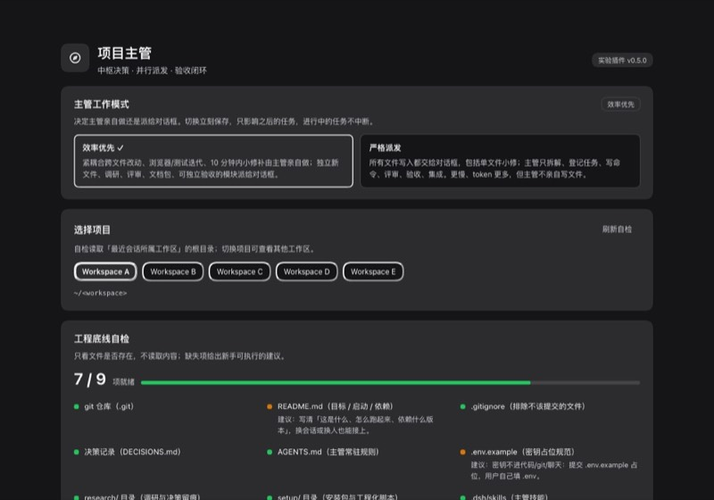
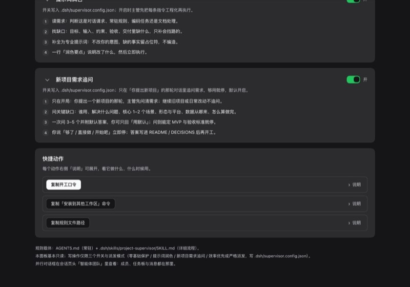

# dsh-project-supervisor · DSH「项目主管」

> ⚠️ **Beta / 测试中**：这个插件仍在测试阶段，界面与配置字段可能变化；欢迎试用并反馈问题。  
> ⚠️ **Beta / under test**: UI and config fields may still change; feedback is welcome.

[](LICENSE)
[](#状态--status)
[](https://github.com/awesome-dsh-plugin/awesome-dsh-plugin)

**把 DSH 变成项目主管**：常驻作业规则 + 并行对话框调度 + Web「主管」面板。
**A project supervisor for DeepSeek Harness**: standing rules, parallel teammate dialogs, and a supervisor panel.



> 截图为脱敏版：工作区名/路径已替换为占位符。 / Screenshots are redacted.

## 它是什么 / What it is

- **常驻规则包**：把 `AGENTS.md`、两个技能（项目主管、提示词润色）和《主管手册》装进任意工作区——开会话就自动以「主管」方式工作：拆目标、登记任务板、用 Agent Teams 并行打开对话框架、验收产物。
- **Web「主管」面板**（本仓库根目录即 DSH 插件包）：工程底线自检、主管工作流、快捷口令、三个可持久化开关（零基础保护 / 提示词润色 / 新项目需求追问）和页面最上端的工作模式选择（效率优先 / 严格派发）。
- **分享包内容**（`kit/`）：一条命令把主管装进任意工作区（macOS/Linux/Windows）；含模板、调研报告与可选权限补丁。维护/打包脚本在源工作区，不随公开仓库分发。
- **可选权限补丁**：给单个对话框按风险传沙箱范围（`read-only` / `workspace-write` / `danger-full-access`）与只读工具白名单。

## 快速开始 / Quick start

### 1) 安装 DSH Web 面板（本仓库即插件包）

市场收录后可在 DSH 插件市场（插件 → 发现）搜索 *项目主管*；当前处于测试期、市集审核中，可直接从 GitHub 安装：

```bash
dsh plugin --profile web add github:Midnight-1991/dsh-project-supervisor
# 然后重启 dsh web，并在侧栏打开「主管」
```

本地开发也可以 `link:` 安装本仓库，见 `kit/安装说明.md`。

### 2) 给某个工作区建立主管规则（可选，但推荐）

从本仓库 `kit/` 目录，或从 [Releases](https://github.com/Midnight-1991/dsh-project-supervisor/releases) 下载分享包 zip（解压后运行）——两者等价：

```bash
# macOS / Linux
bash kit/install-supervisor.sh /path/to/your-workspace --with-research

# Windows（PowerShell / CMD）
node kit/install-supervisor.mjs C:\path\to\your-workspace --with-research
```

装完用 DSH 打开该工作区、新建会话（cwd 必须是该目录），直接说目标即可。

### 3) 试试

> 帮我做一个记账小工具

主管会先追问关键需求（可在面板关掉），再给 MVP、拆任务、按需并行开对话框、验收后汇报。

## 面板里有什么 / Panel



| 区域 | 说明 |
|---|---|
| 主管工作模式 | 最上端：效率优先（默认）/ 严格派发；写入 `.dsh/supervisor.config.json` 的 `dispatchMode` |
| 选择项目 | 按会话 cwd 去重，默认选含 `AGENTS.md` 的项目；可手动切换 |
| 工程底线自检 | 9 项探测：`.git`、`README.md`、`.gitignore`、`DECISIONS.md`、`AGENTS.md`、`.env.example`、`research/`、`setup/`、`.dsh/skills` |
| 三张开关卡片 | 零基础保护、提示词润色、新项目需求追问；默认全开，可折叠并存住选择 |
| 快捷动作 | 复制开工口令、复制套件安装命令、复制规则路径；每项带可展开说明 |

严格派发模式下：任何文件写入都交给对话框，主管只拆解、评审、验收、集成。

## 兼容性 / Compatibility

- macOS：完整实测（DSH `0.2.0-rc.2`，Chrome/Web GUI）。
- Windows：安装器与路径/HTTP 链路有 `compat-check` 32 项离线断言，但**尚未在真实 Windows 机器上端到端实测**；装了遇到崩溃请附 `~/.dsh` 日志反馈。
- Linux：未实测；脚本为纯 bash/Node，理论可用。

## 仓库结构 / Layout

```text
.                     # DSH 插件包（package.json 含 dsh.bundle / dsh.client）
├── index.js          # host 半侧：配置 endpoint（GET/POST，同源 + $HOME 校验 + 原子写）
├── client.js         # 「主管」面板 client 半侧（手写 bundle，无构建步骤）
├── cordis.patch.yml  # 插件注册行
├── install-plugin.*  # 本地安装器（.sh / .mjs，Windows 用 .mjs）
├── scripts/          # smoke / host-smoke / e2e-screenshot / compat-check
├── screenshots/
└── kit/              # 规则包与工程化套件（装到别的工作区用）
    ├── AGENTS.md
    ├── 主管手册.md
    ├── .dsh/skills/  # project-supervisor + improving-prompts
    ├── setup/        # install / sync / build-dist / selftest / verify-facts / patches
    └── research/     # 设计依据与调研（8 份报告 + 决策记录）
```

## 开发与自测 / Development

```bash
# 插件本体
node scripts/smoke.mjs          # client bundle 离线注册断言
node scripts/host-smoke.mjs     # host endpoint 16 项断言（假 ctx/req/res）
node scripts/compat-check.mjs   # Windows/路径/HTTP 崩溃安全 32 项

# 分享包安装器（在仓库根目录）
bash kit/install-supervisor.sh /tmp/test-workspace --with-research   # macOS/Linux
node kit/install-supervisor.mjs /tmp/test-workspace --with-research  # Windows/跨平台
```

浏览器 e2e 脚本 `scripts/e2e-screenshot.mjs` 需要本机 DSH 地址与 token（见脚本头注释），只用于开发者。

## 状态 / Status

**Beta（测试中）**。当前：插件 0.5.0 / 规则套件 1.8.0。已完成：面板 UI、四类配置、跨平台崩溃安全、工作流硬化 14 条 + 技能模板分发（v1.8.0）、套件安装/分享、独立评审修复；未完成：Windows 真机 e2e、更多真实项目演练、DSH 版本升级后的兼容回归。

## 许可证与第三方 / License

本仓库采用 **MIT License**，全文见 [LICENSE](LICENSE)。

第三方组件与致谢：

- `improving-prompts` 技能来自 [theultimate-dev/skills](https://github.com/theultimate-dev/skills/tree/main/skills/prompt-engineering/improving-prompts)，MIT © 2026 Igor Wnek；
- 工作流机制参考 [obra/superpowers](https://github.com/obra/superpowers)（MIT © 2025 Jesse Vincent）：本项目的「工作流硬化」借鉴其流程思想（计划落文件、实现/评审分离、完成声明过验证门、有界返工、任务账本等），规则与模板为独立撰写，未复制其代码或长段原文。

完整清单、各自 MIT 全文与使用范围见 [THIRD_PARTY_NOTICES.md](THIRD_PARTY_NOTICES.md) 及 `kit/.dsh/skills/improving-prompts/LICENSE`。

> 这不是 DeepSeek 官方项目；DSH 与 DeepSeek 是其各自权利人的商标。
