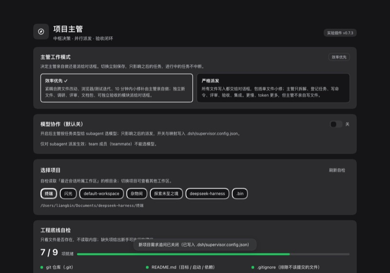
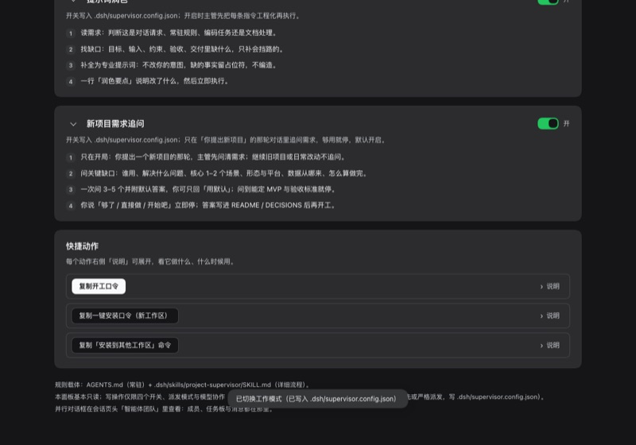
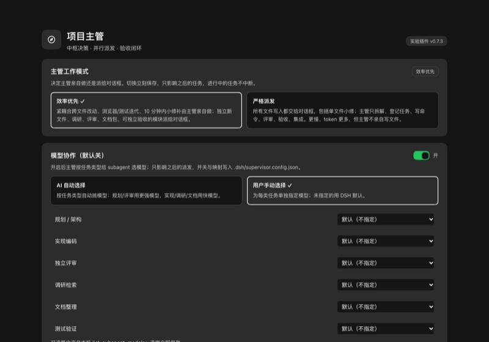

# dsh-project-supervisor（项目主管面板 · DSH 插件实验版）

把「项目主管」体系搬到 DeepSeek Harness 的 Web GUI 里：侧栏多一个 **主管** 入口，点开是一块面板（除「零基础保护」「提示词润色」「新项目需求追问」「模型协作」四个开关、工作模式与模型协作模式选择外只读），用来确认当前工作区是否具备主管开工所需的工程底线，并给出主管工作流、零基础保护清单与一键复制的开工口令。


> 截图均为脱敏版：工作区名/路径替换为占位符，侧栏会话与第三方浮层不截入。 / Screenshots are redacted.

> 截图来自 2026-10-24 的 headless Chrome e2e（暗色主题、真实 DSH Web 页面，点击侧栏「主管」后截取）。

> 规则本身仍在 `AGENTS.md` 和 `.dsh/skills/project-supervisor/SKILL.md`（文件载体）；本插件只负责看板与入口。仅有的写操作是四个开关（零基础保护、提示词润色、新项目需求追问、模型协作）与工作模式/模型协作模式选择（写 `<工作区>/.dsh/supervisor.config.json`），不替代对话里的主管。

## 面板里有什么

| 区块 | 内容 |
|---|---|
| 主管工作模式 | 页面**最上端**：效率优先 / 严格派发 二选一（默认效率优先），决定主管亲自做还是把写入都派给对话框 |
| 选择项目 | 从最近的会话里按工作区（cwd）去重，默认最近一个；可切换到其他工作区 |
| 工程底线自检 | 9 项探测：`.git`、`README.md`、`.gitignore`、`DECISIONS.md`、`AGENTS.md`、`.env.example`、`research/`、`setup/`、`.dsh/skills`；缺失项给新手可执行建议，显示 `x / 9` 就绪 |
| 主管怎么工作 | 给目标 → 拆解并行 → 验收产物 → 收尾留痕，四步卡片 |
| 零基础保护 | 安全网 / 先读回 / MVP / 架构默认 / 密钥 / 文档即记忆，六条；卡片右上角滑块可关闭（关闭后不再主动引导，安全底线保留） |
| 提示词润色 | 读需求 / 找缺口 / 补全为专业提示词 / 一行要点后立即执行，四步；卡片右上角滑块可关闭（关闭后直接按原话执行） |
| 快捷动作 | 复制开工口令（口令内含规则文件路径）、复制一键安装口令（新工作区）、复制「安装到其他工作区」命令（复制成功有 toast）；每个动作右侧「说明」可展开/折叠作用与使用时机 |
| 折叠说明 | 三个开关卡片的简介/清单可点标题左侧箭头折叠（默认展开）；折叠选择存在浏览器 localStorage，下次打开面板沿用 |
| 页脚 | 规则载体说明、并行对话框入口提示（会话页头「智能体团队」） |

（快捷动作的「说明」可展开，截图省略以控制分享包体积。）

## 安装（本机 DSH）

```bash
# macOS / Linux（bash，仅需 Node ≥18，不需要 python3）
bash install-plugin.sh                    # 装进 ${DSH_HOME:-~/.dsh}/profiles/web
bash install-plugin.sh --dry-run          # 只预览：会改哪些配置、怎么建链接，不写盘
bash install-plugin.sh --uninstall        # 卸载（先备份 profile 配置）
PROFILE=other bash install-plugin.sh      # 装进其他 profile

# Windows / 任意平台（Node ≥18，推荐）
node install-plugin.mjs                   # 装进 ${DSH_HOME:-~/.dsh}/profiles/${PROFILE:-web}
node install-plugin.mjs --dry-run         # 预览
node install-plugin.mjs --uninstall       # 卸载
node install-plugin.mjs --profile <profile目录>   # 装进其他 profile
node install-plugin.mjs --copy            # 强制复制（默认 Windows 用 junction，失败自动复制）
```

环境变量：`DSH_HOME`（默认 `~/.dsh`）、`PROFILE`（默认 `web`）、`PROFILE_DIR`（直接指定 profile 目录，优先级最高）。

脚本做四件事（幂等，改动前备份 profile 的 `package.json` + `cordis.patch.yml` 到 `.backups/<时间戳>/`）：

1. 把插件包软链（或复制）到 `<profile>/node_modules/dsh-project-supervisor`——建链/复制前先安全删除旧条目，避免 `目标/目标` 嵌套；
2. 在 `<profile>/package.json` 的 `dependencies` 里加 `"dsh-project-supervisor": "link:<插件绝对路径>"`；
3. 把 `dsh-project-supervisor` 加入 `dsh.profile.bundles`；
4. 写 `<profile>/.dsh-project-supervisor.json`（version / installedAt / mode / pluginDir），重复安装只刷新链接或复制、不重复备份。

卸载：先备份 profile 配置，再删除 `dependencies` / `bundles` 条目与 `node_modules` 条目（copy 安装的真实目录会递归删除）；未安装时重复卸载会提示「未安装」并 exit 0，不报错。

然后刷新 DSH 页面（或重启 `dsh web`）。侧栏出现「主管」入口即成功。

## 面板开关（零基础保护 / 提示词润色 / 新项目需求追问 / 模型协作）




三块卡片右上角的滑块把开关状态持久化到当前工作区的 `<cwd>/.dsh/supervisor.config.json`：
- `beginnerGuard`（默认 true）：关闭后主管不再主动做零基础引导，安全底线保留；
- `promptPolish`（默认 true，缺字段按 true）：关闭后主管直接按用户原话执行，不再先做提示词润色（仍写明关键假设）。
- `requirementInterview`（默认 true，缺字段按 true）：关闭后主管不在新项目开局主动追问；用户说「先问清需求」仍可临时执行。

页面最上端还有**主管工作模式**（不是开关，是二选一）：`dispatchMode` 为 `efficiency`（默认）或 `strict`，决定主管自己写文件还是把每次写入派给对话框。

```json
{ "beginnerGuard": false, "promptPolish": true, "requirementInterview": true, "dispatchMode": "efficiency", "updatedAt": "2026-10-24T14:30:00.000Z", "source": "dsh-project-supervisor" }
```

- 关闭后，主管开工读到该文件就跳过主动的新手引导（MVP 解释、架构建议、备份提醒、说人话）；密钥、不可逆动作确认、每步跑通等安全底线仍保留。文件不存在或 `beginnerGuard` 为 `true` 时默认开启。
- 读写走插件 host 半侧的同源 endpoint：`GET /plugins/dsh-project-supervisor/config?cwd=...`、`POST /plugins/dsh-project-supervisor/config`；同源校验、路径必须在 `$HOME` 下、`tmp + rename` 原子写。
- host 半侧在 DSH 启动时加载：**装/改插件后需重启 `dsh web`** 才能写工作区文件。重启前面板会先存浏览器 localStorage，并提示「重启 DSH 后同步到工作区」。

## 主管工作模式（效率优先 / 严格派发）



| 模式 | 谁写文件 | 适合 |
|---|---|---|
| **效率优先**（`efficiency`，默认） | 紧耦合跨文件改动、浏览器/测试迭代、10 分钟内小修补由主管亲自做；独立新文件、调研、评审、文档包、可独立验收的模块派给对话框 | 日常 |
| **严格派发**（`strict`） | 所有文件写入都交给对话框（哪怕改一句话）；主管只拆解、登记、写命令、评审、验收、集成，不亲自写文件 | 验证「主管只指挥」、高风险或需留痕项目 |

- 状态写 `<cwd>/.dsh/supervisor.config.json` 的 `"dispatchMode"`；主管开工先读，切换只影响之后的新任务。
- 严格模式更慢、token 更多；主管若因成员上限/Team 工具不可用派不出对话框，会停下说明阻塞，不会静默改回自己写。

## 依赖与兼容性

- 需要 `dsh` 0.2.0-rc.2 的 **Web** profile（客户端插件的 `main` / `sidebar.panellist` slot、`workspaceFiles` remote 均来自该版本）。
- host 半侧 `index.js` 只注册一个配置 endpoint（GET/POST 五个配置字段（含 modelCollaboration 组），见上文），无其他副作用；离线 smoke 可验证。
- 数据来源为 `workspaceFiles` remote 的 `stat`：只判断文件/目录是否存在，**不读取内容**。
- 没有 `workspaceFiles` 服务时面板会降级为静态内容（规则卡与快捷动作仍可用）。

## 已实测（2026-10-24，安装器更新于 2026-10-25）

- 安装进 `~/.dsh/profiles/web` 后，真实 DSH Web GUI 侧栏出现「主管」入口，面板渲染 9 项自检、5 个项目 chip，切换项目分数从 `0/9` 变为 `7/9`；
- 快捷动作点击后有 toast（headless 无剪贴板权限时显示「复制失败」，真实浏览器有用户手势与 `navigator.clipboard`）；
- 零基础保护开关：e2e 断言默认开 → 点击关闭（6 条列表隐藏 + toast）→ 再点击恢复，`true → false → true`；
- 提示词润色开关：默认开（4 步清单）→ 关闭（清单隐藏 + 提示文案）→ 恢复，`true → false → true`；
- 快捷动作阐释：e2e 断言 3 个「说明」折叠开关默认收起、点开显示恰好 1 条阐释（含「作用」）、再点收起；
- 三块开关卡片说明区折叠（插件 0.4.1）：e2e 断言默认展开、折叠后卡片体消失且 `psup.collapsed.*` 写入 localStorage、刷新页面仍保持折叠、其余卡片不受影响；
- 主管工作模式（插件 0.5.0）：e2e 断言选择器位于页面最上端、默认「效率优先」选中、点击「严格派发」后 `aria-checked` 翻转、刷新页面仍保持严格派发，跑完自动恢复效率优先；
- host 半侧 `scripts/host-smoke.mjs` 16 项离线断言全 PASS（四字段默认值、写入/读回、单字段写入不重置其他字段、非法 dispatchMode 400、跨域 403、非法/越权 cwd 400、405）；
- 运行时无异常、无 console error；深浅两套主题均使用宿主设计变量，暗色截图见上。
- 安装器健壮性（2026-10-25）：26 条断言覆盖 symlink/copy 安装、损坏 JSON 非 0、`--dry-run` 零写入、两种卸载、无 python3 PATH、真实 profile 未被触碰；`--dry-run` / `--copy` / `--profile` / `DSH_HOME` 均实测生效。

## 从主管套件安装

`setup/build-dist.sh` 构建的分享包内包含 `plugin/dsh-project-supervisor/`。解压后：

```bash
cd project-supervisor-kit-<日期>/plugin/dsh-project-supervisor
bash install-plugin.sh            # 或先 bash install-plugin.sh --dry-run 看计划
```

## 模型协作（默认关，面板可开）

面板第二块「模型协作」：默认关；打开后二选一——「AI 自动选择」（默认，展开 6 行可编辑「自动路由表」，逐任务选模型或留「推荐默认」）或「用户手动选择」（6 行任务类型→模型指派）。状态写 `<工作区>/.dsh/supervisor.config.json` 的 `modelCollaboration`（`autoRoutes` / `assignments`）。



- 仅 `subagent` 支持跨模型（`provider`/`model` 成对）；`spawn_teammate` 不能选模型。
- 模型下拉由 host 端 `/plugins/dsh-project-supervisor/models` 从本机 LLM 服务动态枚举（读不到时回退内置 deepseek-flash / deepseek-v4-pro）；换机器/换 provider 后重选。

## 一键安装口令（给任意新工作区）

面板「快捷动作」新增「复制一键安装口令（新工作区）」：复制后粘贴到任意新工作区的新会话，agent 会从 GitHub 下载套件、装进当前工作区并逐项验收；装完在同一目录新建会话让常驻规则生效。

口令全文与出处见套件 `一键安装口令.md`（也随分享包分发）；口令默认带 `--with-research --with-setup`（把 `research/` 调研资料与 `setup/` 工程化脚本一起装进目标工作区），不需要就在命令里去掉这两个参数；适用于换电脑、朋友第一次用、给已有项目补装主管规则。

安装器幂等：默认只补缺失文件、不覆盖已有文件；验收清单与版本记录在目标工作区 `.dsh/supervisor-kit.json`。

## 开发与自测

无构建步骤（手写客户端 bundle，直接由宿主提供）。改完 `client.js` 后：

```bash
node --check index.js
node --check client.js
node scripts/smoke.mjs      # 客户端 bundle 注册断言
node scripts/host-smoke.mjs  # host 半侧 endpoint 离线断言
```

`smoke.mjs` 用 `node:vm` + 假 `__ModuleLoader__`/React/ctx，校验 factory 注册、inject 列表、locale 字典、`main` 与 `sidebar.panellist` slot 注册，可离线运行。

真实浏览器 e2e（需要带 token 的 `dsh web` 地址，会启动一次性 headless Chrome 并截图）：

```bash
node scripts/e2e-screenshot.mjs "http://127.0.0.1:3080/?token=<token>" /tmp/shots
```

## Windows 兼容性与崩溃安全（v0.4.2）

- **安装无需 bash**：`node install-plugin.mjs` 一行完成；Windows 默认用 junction 链接，创建失败自动退回复制（不用管理员权限/开发者模式）。
- **路径**：home 目录用 `os.homedir()`（Windows 没有 `$HOME`）；home 归属判断按平台分隔符，Windows 下大小写不敏感；`C:\Users\...` 路径按 Windows 语义处理。
- **不让 DSH 崩**：导入插件无副作用；`apply()` 整体 try/catch（host API 缺失/路由注册失败只禁用面板，不影响 profile 加载）；HTTP handler 任何异常都返回 JSON，响应已断开也不会抛到进程；损坏的 `supervisor.config.json` 自动回退默认值。
- **已验证**：`node scripts/compat-check.mjs`（32 项）覆盖 win32 路径模拟（盘符/反斜杠/大小写/UNC/越界）、apply 异常注入、403/400/405/413/损坏配置/断连响应、安装/卸载/幂等/回滚；macOS 真机 e2e 仍全 PASS。
- **没验证的**：真机 Windows 硬件与 DSH 进程（本机是 macOS）。朋友请按《朋友测试指南》第 8 节做一次人工冒烟。
- **恢复**：若 DSH 起不来，`node install-plugin.mjs --uninstall`（非默认 profile 加 `--profile <目录>`）后重启；仍不行就删 profile `package.json` 里 `dsh-project-supervisor` 的两处条目。

## 限制（v0.7.3）

- 面板除四个开关、工作模式与模型协作选择外只读：不会替你执行 git init、写 README、开对话框；这些动作仍由对话里的主管完成。
- 严格派发模式完全依赖 Agent Teams 可创建对话框：成员上限已满或会话未启用 Team 工具时会明确报阻塞，不会假装派发。
- 项目选择基于会话记录的 `cwd`：没有会话记录的工作区不会出现（先在 DSH 打开它并新建会话）。
- 自检只判存在性，不校验内容质量；`.dsh/skills` 探测的是项目级技能目录，全局技能不在此列。
- 改客户端 `client.js` 后刷新页面即可（HMR 需要源码仓库 dev watcher，本地 link 安装没有）；改 host 半侧 `index.js` 后需要**重启 `dsh web`**。
- 开关在 host 半侧未加载时只写浏览器 localStorage，重启 DSH 后才会写入工作区文件。
- 全局面板拿不到「当前选中会话」（客户端未暴露该状态），默认自动挑最近且带 `AGENTS.md` 的项目；可在 chip 里手动切换。
- 快捷动作在无剪贴板权限的环境（如 headless 测试）会退化为「复制失败」提示，需要手动复制。
- 安装状态文件在 profile 根 `.dsh-project-supervisor.json`；同一秒内多次卸载的备份目录会自动加 `-2` 后缀。
- `install-plugin.sh` 只做 symlink 安装（无 copy 回退）；需要复制安装请用 `node install-plugin.mjs --copy`。

## 发给朋友测试

本插件随「项目主管」分享包分发（`dist/project-supervisor-kit-<日期>.zip`）。朋友解压后：

```bash
bash plugin/dsh-project-supervisor/install-plugin.sh --dry-run   # 先看计划，不写盘
bash plugin/dsh-project-supervisor/install-plugin.sh             # 安装到默认 web profile（幂等、自动备份）
# 刷新 DSH 页面 → 侧栏出现「主管」；改 host 半侧后需重启 dsh web 才生效
bash plugin/dsh-project-supervisor/install-plugin.sh --uninstall # 卸载（先备份；重复卸载幂等）
```

完整测试清单、反馈模板与已知限制见分享包根目录的 `朋友测试指南.md`；第三方组件许可证见 `THIRD_PARTY_NOTICES.md`。

## License

MIT。第三方组件（improving-prompts）的版权与许可证见分享包 `THIRD_PARTY_NOTICES.md`。
