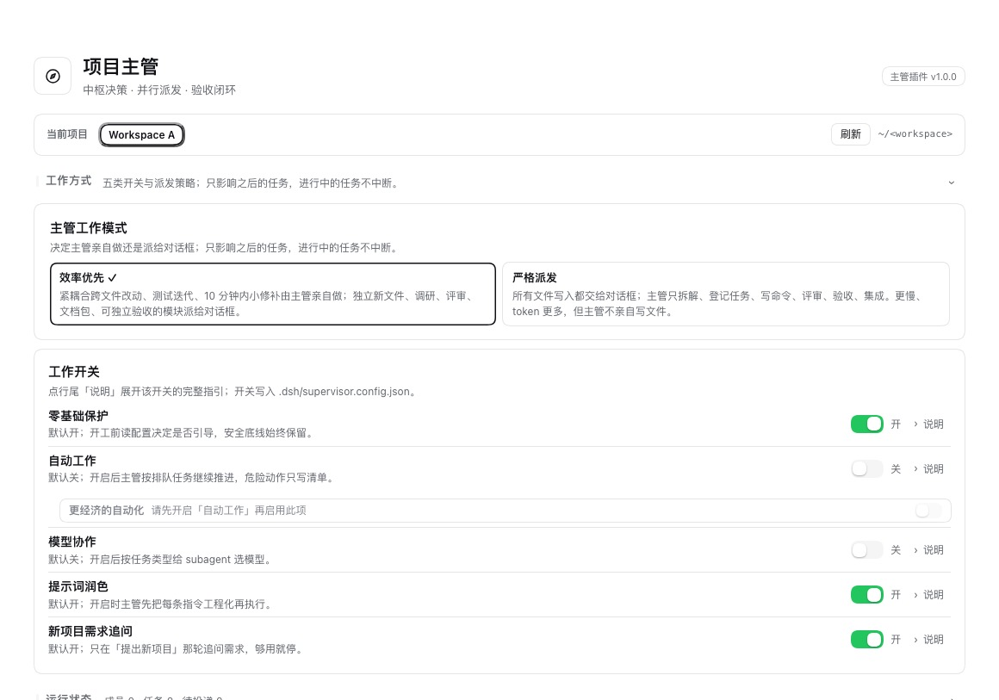
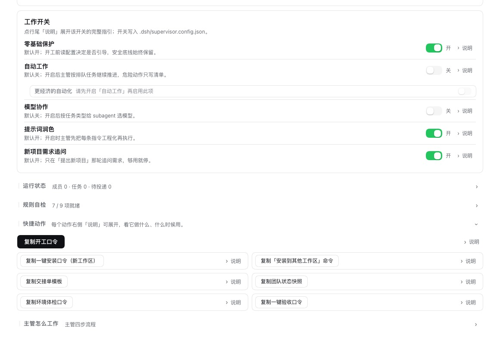
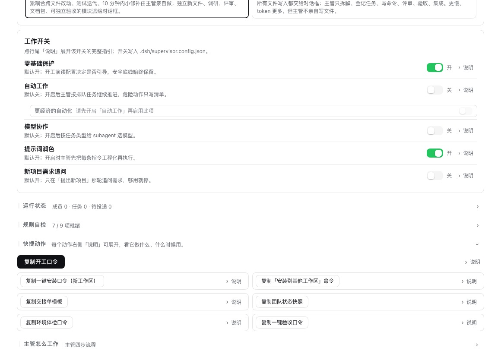
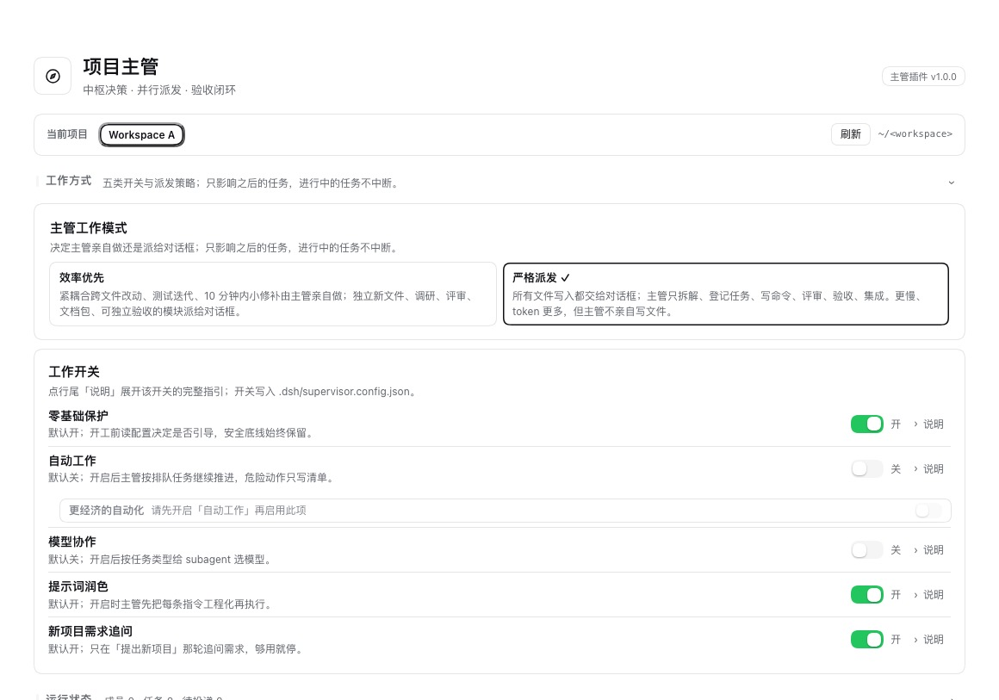

# dsh-project-supervisor（项目主管面板 · DSH 插件 v1.0.0 正式版）

> **v1.0.0 大版本（正式版）**：自动工作 P0/P1 + 队列消息只读 + 更经济的自动化（DeepSeek 谷价时段）+ 面板四分区 / 分区与行级折叠 + 模型协作。

把「项目主管」体系搬到 DeepSeek Harness 的 Web GUI 里：侧栏多一个 **主管** 入口，点开是一块面板（除「零基础保护」「提示词润色」「新项目需求追问」「自动工作」（行内还嵌一个「更经济的自动化」次级开关）「模型协作」五个开关、工作模式与模型协作模式选择外只读），用来确认当前工作区是否具备主管开工所需的工程底线，并给出主管工作流、零基础保护清单、「团队与任务」只读运行态卡与一键复制的开工/交接/验收口令。





> 截图均为脱敏版：工作区名/路径替换为占位符，侧栏会话与第三方浮层不截入。 / Screenshots are redacted.

> 截图来自 2026-10-24 的 headless Chrome e2e（暗色主题、真实 DSH Web 页面，点击侧栏「主管」后截取）。

> 规则本身仍在 `AGENTS.md` 和 `.dsh/skills/project-supervisor/SKILL.md`（文件载体）；本插件只负责看板与入口。仅有的写操作是五个开关（零基础保护、提示词润色、新项目需求追问、自动工作、模型协作，其中「自动工作」行内还有一个「更经济的自动化」次级开关）与工作模式/模型协作模式选择（写 `<工作区>/.dsh/supervisor.config.json`），不替代对话里的主管。

## 面板里有什么

v1.0.0 的面板是单列滚动页：顶部当前项目条 → 四个命名分区（工作方式 / 运行状态 / 规则自检 / 快捷动作）→ 使用说明。工作方式区固定两张**全宽卡**（主管工作模式 + 工作开关清单），不再用旧版卡片墙或两列配对，因此任何开关状态下都不会出现卡内大片空白；响应式改用容器查询按内容宽度收紧（模式选项 <720px 单列、模型路由 <560px 单列、自检清单 <560px 单列、动作网格 <860px 单列、四步说明 <860px 两列 / <560px 单列）。四个 `[data-zone]` 分区与使用说明各自带一个标题行折叠控件（右侧 chevron 按钮，支持键盘、`aria-expanded`/`aria-controls`）：**默认只展开「工作方式」与「快捷动作」**，运行状态 / 规则自检 / 使用说明收起为一行（标题 + 灰色摘要，如「成员 0 · 任务 0 · 待投递 0」「0 / 9 项就绪」「主管四步流程」），点标题行或右侧按钮即可展开；折叠偏好存 localStorage `psup.zone.<zone>`，与行级 `psup.collapsed.<field>` 互不影响。

- **顶部当前项目条**：最近会话按工作区去重后的 chips（默认最近一个，可切换）、小号「刷新」幽灵按钮、当前路径（保留项目名的中间省略 mono、右对齐）。
- **工作方式（两张全宽卡）**：①「主管工作模式」卡内效率优先 / 严格派发二选一（内容宽 <720px 时单列）；②「工作开关」清单卡：零基础保护、自动工作、模型协作、提示词润色、新项目需求追问 5 行，每行左侧名称 + 一句话说明、右侧开关，行尾「说明」按钮可展开该行的完整指引（零基础 6 条 / 润色 4 步 / 追问 4 条 / 自动工作说明 / 模型协作模式与 6 行路由表；模型协作开启时自动展开、关闭时收起）；「自动工作」行内还嵌一个缩进次级行「更经济的自动化」（小号开关 + 单行说明，`autoWork` 关闭时置灰不可点）。折叠偏好存 localStorage（`psup.collapsed.<field>`），默认全部收起。
- **运行状态**：团队与任务只读卡（成员 / 任务 / 待投递计数，数值随顶部「刷新」一起更新，卡内不再放重复刷新按钮）。
- **规则自检**：工程底线自检 `x / 9` 分数 + 进度条 + 9 项两列清单（状态点 + 名称），缺失项建议统一列在网格下方。
- **快捷动作**：复制开工口令（主按钮，宽度随内容、右侧「说明」同框对齐）+ 其余 6 个紧凑动作（2 列网格，每个右侧「说明」可展开/折叠作用与使用时机）；复制失败时会弹出「手动复制」层（只读文本域、自动全选、一键关闭），不再只给死路 toast。
- **使用说明**：主管四步流程（带分区标题，4 列紧凑）+ 两行页脚（规则载体 / 并行入口）。

分区间距 20px、卡片圆角 12px、卡片内边距 16×18px（真实 e2e 微调后）。默认收起态整页高约 1196px（真实 e2e，1440×813），硬断言 ≤1250px，首屏仍完整可见 5 行开关且「运行状态」标题进入首屏。写操作仍只限五个开关与工作模式/模型协作选择，其余只读。各区块内容：

| 区块 | 内容 |
|---|---|
| 主管工作模式 | 工作方式区首卡：效率优先 / 严格派发 二选一（默认效率优先），决定主管亲自做还是把写入都派给对话框 |
| 工作开关 | 工作方式区第二卡：五行开关清单（顺序：零基础保护 → 自动工作 → 模型协作 → 提示词润色 → 新项目需求追问），行尾「说明」展开完整指引 |
| 自动工作 | 默认关；开启后主管不再因提问/授权弹窗卡住，按 `.dsh/auto-work-queue.md` 的排队任务继续推进；开启时行内只读显示「排队 / 阻塞 / 待回答」计数（GET 只读路由）；行内嵌套「更经济的自动化」次级开关（默认关，需先开自动工作） |
| 模型协作 | 默认关；开启时自动展开行说明，二选一——「AI 自动选择」（默认，6 行可编辑自动路由表）或「用户手动选择」（6 行任务类型→模型指派），详见下文小节 |
| 零基础保护 | 安全网 / 先读回 / MVP / 架构默认 / 密钥 / 文档即记忆，六条；行尾开关可关闭（关闭后不再主动引导，安全底线保留） |
| 提示词润色 | 读需求 / 找缺口 / 补全为专业提示词 / 一行要点后立即执行，四步；行尾开关可关闭（关闭后直接按原话执行） |
| 新项目需求追问 | 只在「提出新项目」那轮追问需求（谁用/解决什么/场景/平台/数据/验收），3–5 个给默认，够用就停；行尾开关可关闭 |
| 当前项目条 | 从最近的会话里按工作区（cwd）去重，默认最近一个；可切换工作区，右侧路径保留末尾（项目名可见）的中间省略 |
| 团队与任务 | 只读解析 lead 会话日志的 `team/member`、`team/task`（取最大 revision）与 `queued−delivered` 待投递消息：成员、任务状态徽标 + owner + subject + 写范围数、待投递预览；随顶部「刷新」一起重读，无数据时只显示一行空态提示 |
| 工程底线自检 | 9 项探测：`.git`、`README.md`、`.gitignore`、`DECISIONS.md`、`AGENTS.md`、`.env.example`、`research/`、`setup/`、`.dsh/skills`；缺失项建议列在网格下方，显示 `x / 9` 就绪 |
| 主管怎么工作 | 给目标 → 拆解并行 → 验收产物 → 收尾留痕，页面底部四步紧凑说明，带分区标题 |
| 快捷动作 | 7 个动作：复制开工口令、复制一键安装口令（新工作区）、复制「安装到其他工作区」命令、复制交接单模板、复制团队状态快照、复制环境体检口令、复制一键验收口令；除主按钮外 2 列紧凑排布，每个动作右侧「说明」可展开/折叠 |
| 折叠/展开 | 工作开关每行行尾「说明」按钮展开该行指引（默认收起，折叠选择存在浏览器 localStorage，下次打开面板沿用） |
| 分区折叠 | 工作方式 / 运行状态 / 规则自检 / 快捷动作 / 使用说明各有标题行折叠按钮；默认只展开工作方式与快捷动作，其余显示一行摘要；偏好存 `psup.zone.<zone>` |
| 页脚 | 两行：规则载体说明、并行对话框入口提示（会话页头「智能体团队」） |

（快捷动作的「说明」可展开，截图省略以控制分享包体积。）

## 安装（本机 DSH）

```bash
# macOS / Linux（bash，仅需 Node ≥18，不需要 python3）
bash install-plugin.sh                    # 装进 ${DSH_HOME:-~/.dsh}/profiles/web
bash install-plugin.sh --dry-run          # 只预览：会改哪些配置、怎么建链接，不写盘
bash install-plugin.sh --uninstall        # 卸载（先备份 profile 配置）
PROFILE=other bash install-plugin.sh      # 装进其他 profile

# Windows / 任意平台（Node ≥18，推荐）
node install-plugin.mjs                   # 装进 ${DSH_HOME:-~/.dsh}/profiles/${PROFILE:-web}
node install-plugin.mjs --dry-run         # 预览
node install-plugin.mjs --uninstall       # 卸载
node install-plugin.mjs --profile <profile目录>   # 装进其他 profile
node install-plugin.mjs --copy            # 强制复制（默认 Windows 用 junction，失败自动复制）
```

环境变量：`DSH_HOME`（默认 `~/.dsh`）、`PROFILE`（默认 `web`）、`PROFILE_DIR`（直接指定 profile 目录，优先级最高）。

脚本做四件事（幂等，改动前备份 profile 的 `package.json` + `cordis.patch.yml` 到 `.backups/<时间戳>/`）：

1. 把插件包软链（或复制）到 `<profile>/node_modules/dsh-project-supervisor`——建链/复制前先安全删除旧条目，避免 `目标/目标` 嵌套；
2. 在 `<profile>/package.json` 的 `dependencies` 里加 `"dsh-project-supervisor": "link:<插件绝对路径>"`；
3. 把 `dsh-project-supervisor` 加入 `dsh.profile.bundles`；
4. 写 `<profile>/.dsh-project-supervisor.json`（version / installedAt / mode / pluginDir），重复安装只刷新链接或复制、不重复备份。

卸载：先备份 profile 配置，再删除 `dependencies` / `bundles` 条目与 `node_modules` 条目（copy 安装的真实目录会递归删除）；未安装时重复卸载会提示「未安装」并 exit 0，不报错。

然后刷新 DSH 页面（或重启 `dsh web`）。侧栏出现「主管」入口即成功。

## 面板开关（零基础保护 / 提示词润色 / 新项目需求追问 / 自动工作 / 模型协作）




各卡片右上角的滑块把开关状态持久化到当前工作区的 `<cwd>/.dsh/supervisor.config.json`：
- `beginnerGuard`（默认 true）：关闭后主管不再主动做零基础引导，安全底线保留；
- `promptPolish`（默认 true，缺字段按 true）：关闭后主管直接按用户原话执行，不再先做提示词润色（仍写明关键假设）。
- `requirementInterview`（默认 true，缺字段按 true）：关闭后主管不在新项目开局主动追问；用户说「先问清需求」仍可临时执行。
- `autoWork`（**默认 false**，见下节）：无人值守自动工作总开关；关闭时主管仍按普通交互节奏工作。
- `economicalAutoWork`（**默认 false**，嵌套在「自动工作」行内）：只约束自动工作的模型调用走 DeepSeek 谷价时段；需先开启 `autoWork` 才能点，关闭时置灰但保留已存值。

页面最上端还有**主管工作模式**（不是开关，是二选一）：`dispatchMode` 为 `efficiency`（默认）或 `strict`，决定主管自己写文件还是把每次写入派给对话框。

```json
{ "beginnerGuard": false, "promptPolish": true, "requirementInterview": true, "autoWork": false, "economicalAutoWork": false, "dispatchMode": "efficiency", "updatedAt": "2026-10-24T14:30:00.000Z", "source": "dsh-project-supervisor" }
```

- 关闭后，主管开工读到该文件就跳过主动的新手引导（MVP 解释、架构建议、备份提醒、说人话）；密钥、不可逆动作确认、每步跑通等安全底线仍保留。文件不存在或 `beginnerGuard` 为 `true` 时默认开启。
- 读写走插件 host 半侧的同源 endpoint：`GET /plugins/dsh-project-supervisor/config?cwd=...`、`POST /plugins/dsh-project-supervisor/config`；同源校验、路径必须在 `$HOME` 下、`tmp + rename` 原子写。
- host 半侧在 DSH 启动时加载：**装/改插件后需重启 `dsh web`** 才能写工作区文件。重启前面板会先存浏览器 localStorage，并提示「重启 DSH 后同步到工作区」。

## 主管工作模式（效率优先 / 严格派发）



| 模式 | 谁写文件 | 适合 |
|---|---|---|
| **效率优先**（`efficiency`，默认） | 紧耦合跨文件改动、浏览器/测试迭代、10 分钟内小修补由主管亲自做；独立新文件、调研、评审、文档包、可独立验收的模块派给对话框 | 日常 |
| **严格派发**（`strict`） | 所有文件写入都交给对话框（哪怕改一句话）；主管只拆解、登记、写命令、评审、验收、集成，不亲自写文件 | 验证「主管只指挥」、高风险或需留痕项目 |

- 状态写 `<cwd>/.dsh/supervisor.config.json` 的 `"dispatchMode"`；主管开工先读，切换只影响之后的新任务。
- 严格模式更慢、token 更多；主管若因成员上限/Team 工具不可用派不出对话框，会停下说明阻塞，不会静默改回自己写。

## 自动工作（无人值守，默认关）

「工作开关」清单第 2 行「自动工作」：**默认关**。开启后主管在用户离开电脑时：
- 不因弹窗提问/授权请求卡住（配合 P1 的 timed ask 提示与「自动工作」权限预设）；
- 从 `<工作区>/.dsh/auto-work-queue.md` 的「排队任务」继续推进可完成项，推进记录写「自动工作日志」；
- 到停止条件（排队清空 / 只剩阻塞 / 需要用户决策 / 不可逆动作）就停下，回来给完整总结与阻塞清单；
- 开启时行内只读显示 **排队 N · 阻塞 N · 待回答 N** 三个计数，方便睡前看一眼还剩多少。

**安全边界**：自动工作不等于放开一切——删除、发布、推送、花钱等不可逆动作只写进队列/日志，不执行；密钥仍只进 `.env`；遇到必须用户拍板的决定写进「待回答的问题」后停下。

**配置字段**：`autoWork`（boolean，默认 `false`），写 `<工作区>/.dsh/supervisor.config.json`；POST 非布尔值返回 `400 {"ok":false,"error":"invalid-auto-work"}`。其他开关的局部更新语义不变。

### 更经济的自动化（`economicalAutoWork`，默认关）

「自动工作」行内还有一个缩进次级行「更经济的自动化」：

- **生效前提**：必须先开启 `autoWork`；`autoWork` 关闭时小号开关置灰不可点，但保留已存的值。
- **峰谷口径（北京时间）**：高峰 = 周一至周五 09:00–12:00、14:00–18:00（不含法定节假日）；其余时间（含周末/节假日）为谷价；高峰前 20 分钟只收尾，进入谷价后自动续跑。
- **只约束自动工作**：仅限制自动工作调用的模型选择/时机，不影响用户手动使用；全部模型显式非 DeepSeek 时不限制。
- **配置字段**：`economicalAutoWork`（boolean，默认 `false`）；POST 非布尔返回 `400 {"ok":false,"error":"invalid-economical-auto-work"}`，与 `autoWork` 局部更新互不影响。
- **验证**：smoke 断言嵌套行结构（默认关、置灰、点击无副作用、展开体含完整峰谷口径）与 214 对中英 key；host-smoke 断言默认 false / POST true 持久化 / 非法 400；e2e 断言默认可见且 disabled → 开启自动工作后可切换并 toast → reload 保持 → 收尾恢复关，并新增 e2e 内部证据截图 `panel-eco-default.png`。

**队列文件**：`<工作区>/.dsh/auto-work-queue.md`，固定四个二级节：`## 排队任务` / `## 阻塞` / `## 待回答的问题` / `## 自动工作日志`；条目是以 `- ` 开头的行，占位 `- （空）` 不计入数量。模板随主管技能分发（`.dsh/skills/project-supervisor/templates/auto-work-queue.md`）。

**面板只读状态路由**：`GET /plugins/dsh-project-supervisor/auto-work?cwd=<abs>` → `{ok, exists, path, enabled, sections:{queue,blocked,questions}, updatedAt}`；同源校验、路径须在 `$HOME` 下、文件缺失报 `exists:false` 且计数为 0、单条截断 200 字符、每节最多 20 条；**GET 不写任何文件**。

> 改 host 半侧（`index.js`）后需**重启 `dsh web`** 才有新路由；重启前面板会提示「队列状态暂不可用」，开关本身仍先存浏览器 localStorage（`psup.autoWork:<cwd>`）并在 host 生效后写回工作区配置。

## 团队与任务（只读卡，插件 1.0.0）

「运行状态」区有一块**只读**卡片（默认即显示，无需开关，数据随顶部「刷新」按钮一起更新）：

- **团队与任务**：读 lead 会话日志里的 Agent Teams 事件——成员按 id 去重（保留最后一次生命周期）、任务按 revision 取最新、待投递消息 = `team/message/queued` − `team/message/delivered`；预览截 120 字符、单数组最多 200 条。数据来自 `GET /plugins/dsh-project-supervisor/team-board?cwd=<abs>&session=<id>`（只读、同源、home 内路径、session 白名单；日志缺失/截断/无 zstd 都降级为空板 + warning，不抛错）。

本插件不集成、不依赖外部上下文压缩组件：没有代理探测、没有第三方运行态轮询，只解析 DSH 自己的会话日志。

权限与边界：该路由是 **GET only**（非 GET 405、跨源 403、非法 cwd/session 400），只读不写任何文件；host 半侧未重启/路由 404 时卡片显示静态降级提示，不报错、不显示 NaN。

## 依赖与兼容性

- 需要 `dsh` 0.2.0-rc.2 的 **Web** profile（客户端插件的 `main` / `sidebar.panellist` slot、`workspaceFiles` remote 均来自该版本）。
- host 半侧 `index.js` 只注册三个同源 endpoint：配置读写（GET/POST，七个配置字段：五个布尔开关含 autoWork 与次级 economicalAutoWork、dispatchMode、modelCollaboration 组）、自动工作队列只读状态（`/auto-work`）、团队看板（`/team-board`）——后两者 GET only、只读；无其他副作用，离线 smoke 可验证。
- 数据来源为 `workspaceFiles` remote 的 `stat`：只判断文件/目录是否存在，**不读取内容**。
- 没有 `workspaceFiles` 服务时面板会降级为静态内容（规则卡与快捷动作仍可用）。

## 已实测（2026-10-24，安装器更新于 2026-10-25）

- 安装进 `~/.dsh/profiles/web` 后，真实 DSH Web GUI 侧栏出现「主管」入口，面板渲染 9 项自检、5 个项目 chip，切换项目分数从 `0/9` 变为 `7/9`；
- 快捷动作点击后有 toast；headless 无剪贴板权限时不会卡死，而是弹出「手动复制」层（只读文本域 + 自动全选 + 一键关闭），真实浏览器有用户手势与 `navigator.clipboard` 时直接复制成功；
- 零基础保护开关：e2e 断言默认开 → 点击关闭（6 条列表隐藏 + toast）→ 再点击恢复，`true → false → true`；
- 提示词润色开关：默认开（4 步清单）→ 关闭（清单隐藏 + 提示文案）→ 恢复，`true → false → true`；
- 快捷动作阐释：e2e 断言 7 个「说明」折叠开关默认收起、点开显示恰好 1 条阐释（含「作用」）、再点收起；
- 工作开关行「说明」折叠（插件 1.0.0）：e2e 断言 5 行说明默认收起、展开零基础保护行后出现 6 条清单、`psup.collapsed.beginnerGuard` 写入 `0`、刷新页面仍保持展开、其余行保持收起；
- 主管工作模式（插件 0.5.0）：e2e 断言选择器位于「工作方式」区首卡、默认「效率优先」选中、点击「严格派发」后 `aria-checked` 翻转、刷新页面仍保持严格派发，跑完自动恢复效率优先；
- 面板 UI 结构收口（插件 1.0.0）：e2e 断言四个命名分区按序渲染、工作方式区恰好两张全宽卡（主管工作模式 + 工作开关）、5 行开关按「零基础保护 → 自动工作 → 模型协作 → 提示词润色 → 新项目需求追问」排列、首屏完整可见 5 行开关且「运行状态」区标题进入首屏、快捷动作主按钮唯一且不撑满；`scrollHeight` 从旧版基线 2957px（两卡全展开 1812px）降到默认收起态约 1196px（-60%，硬断言 ≤1250px）；零基础保护关闭 / 模型协作开启+手动两种状态；v1.0.0 公开截图为 `panel.jpg` / `panel-middle.jpg` / `panel-bottom.jpg` / `panel-mode-strict.jpg` / `panel-interview-off.jpg`（见 screenshots/），并断言工作方式区没有 >60px 的卡内空洞；每次截图前显式设置滚动位置（top / 45% / bottom / 运行状态区 / 动作区），避免不同状态截到同一屏；e2e 仍会先关闭 DSH 首次启动的「预览版说明 / 添加一个 API Key」引导弹窗、公开截图前临时隐藏 toast；离线 smoke 断言两卡结构、5 行开关、说明默认收起、展开 6 条清单、无重复 key，与 i18n key 的中英对齐（T27 后 214 对）；真实 e2e 复核后又修掉两处：项目条「刷新」按钮禁止换行（真实环境曾被挤成两行）、分区间距 22→20px + 开关行 padding 8→6px（`scrollHeight` 1851→1812，阈值仍硬断言 ≤1850），并把模型协作展开态截图改为只展开该行、折叠其它行后截图，证据可直接证明无卡内空洞；
- 自动工作次级开关（插件 1.0.0）：smoke 断言「工作开关」第 2 行内嵌缩进次级行、小号开关默认 `aria-checked=false` 且 `disabled`（`autoWork` 关闭时不响应点击）、展开体渲染完整峰谷口径（09:00–12:00 / 周末/节假日）、POST/localStorage 回落（`psup.economicalAutoWork:<cwd>`）源码契约，i18n 计数 214 × zh/en 且无重复键；host-smoke 50 checks（默认 false、POST true 持久化且不重置其它字段、非法 'yes'/1/null → `invalid-economical-auto-work`、局部更新保留）；e2e 断言默认态次级行可见但 disabled → 开启自动工作后解除置灰并可切上（独立 toast「更经济」）→ 刷新后保持 → 收尾恢复关，新增 e2e 内部证据截图 `panel-eco-default.png`；默认态 `scrollHeight` 硬断言仍 ≤1250px（离线 harness 实测 1190px、首屏 5 行开关 bottom≈764px、「运行状态」标题 top≈799px，计入次级行后仍有首屏余量）；
- 分区级折叠（插件 1.0.0）：smoke 断言 5 个分区折叠按钮、默认 `aria-expanded`（工作方式/快捷动作展开、运行状态/规则自检/使用说明收起）、`aria-controls`/body id 对应、收起时一行摘要（团队看板降级或成员/任务/待投递计数、`x / 9 项就绪`、`7 个快捷动作`、主管四步流程）、localStorage `psup.zone.<zone>` 落盘与重渲染恢复；e2e 断言默认态收起/展开、摘要文本、点击标题行展开后团队卡与自检清单可见、刷新后分区选择保持、全展开与恢复默认靠 `panel-zones-default.png` / `panel-zones-expanded.png` 两张 e2e 内部证据截图取证；默认态 `scrollHeight` 硬断言 ≤1250px（真实 e2e 实测 1196px，首屏 5 行开关 bottom≈770px、「运行状态」标题 top≈806px；离线 harness 预估 1190px/bottom 764px/top 799px）；i18n 计数 214 × zh/en；
- host 半侧 `scripts/host-smoke.mjs` 50 项离线断言全 PASS（配置字段默认值/写入读回/单字段局部更新、`economicalAutoWork` 次级开关默认值与非法值 400、auto-work 队列计数与占位符/上限/截断、team-board 成员与任务 revision 去重/待投递差集/缺失降级、非法输入 400/405/403）；
- 运行时无异常、无 console error；深浅两套主题均使用宿主设计变量，暗色截图见上。
- 安装器健壮性（2026-10-25）：26 条断言覆盖 symlink/copy 安装、损坏 JSON 非 0、`--dry-run` 零写入、两种卸载、无 python3 PATH、真实 profile 未被触碰；`--dry-run` / `--copy` / `--profile` / `DSH_HOME` 均实测生效。

## 从主管套件安装

`setup/build-dist.sh` 构建的分享包内包含 `plugin/dsh-project-supervisor/`。解压后：

```bash
cd project-supervisor-kit-<日期>/plugin/dsh-project-supervisor
bash install-plugin.sh            # 或先 bash install-plugin.sh --dry-run 看计划
```

## 模型协作（默认关，面板可开）

面板第三块「模型协作」：默认关；打开后二选一——「AI 自动选择」（默认，展开 6 行可编辑「自动路由表」，逐任务选模型或留「推荐默认」）或「用户手动选择」（6 行任务类型→模型指派）。状态写 `<工作区>/.dsh/supervisor.config.json` 的 `modelCollaboration`（`autoRoutes` / `assignments`）。

- 仅 `subagent` 支持跨模型（`provider`/`model` 成对）；`spawn_teammate` 不能选模型。
- 模型下拉由 host 端 `/plugins/dsh-project-supervisor/models` 从本机 LLM 服务动态枚举（读不到时回退内置 deepseek-flash / deepseek-v4-pro）；换机器/换 provider 后重选。

## 一键安装口令（给任意新工作区）

面板「快捷动作」新增「复制一键安装口令（新工作区）」：复制后粘贴到任意新工作区的新会话，agent 会从 GitHub 下载套件、装进当前工作区并逐项验收；装完在同一目录新建会话让常驻规则生效。

口令全文与出处见套件 `一键安装口令.md`（也随分享包分发）；口令默认带 `--with-research --with-setup`（把 `research/` 调研资料与 `setup/` 工程化脚本一起装进目标工作区），不需要就在命令里去掉这两个参数；适用于换电脑、朋友第一次用、给已有项目补装主管规则。

安装器幂等：默认只补缺失文件、不覆盖已有文件；验收清单与版本记录在目标工作区 `.dsh/supervisor-kit.json`。

## 开发与自测

无构建步骤（手写客户端 bundle，直接由宿主提供）。改完 `client.js` 后：

```bash
node --check index.js
node --check client.js
node scripts/smoke.mjs      # 客户端 bundle 注册断言
node scripts/host-smoke.mjs  # host 半侧 endpoint 离线断言
```

`smoke.mjs` 用 `node:vm` + 假 `__ModuleLoader__`/React/ctx/localStorage，校验 factory 注册、inject 列表、locale 字典（214 个 key × zh/en）、`main` 与 `sidebar.panellist` slot 注册，并浅渲染主面板断言工作方式区两张全宽卡、5 行开关顺序与开关契约（`role=switch` + `data-field`）、5 个行尾「说明」默认收起、零基础保护行展开后 6 条清单、7 个快捷动作 + 7 个动作「说明」、无残留旧类名/文案；并断言「自动工作」行内嵌套次级行（名称/单行提示/小号开关默认关且 disabled/展开体含峰谷口径）与 `economicalAutoWork` 的 POST/localStorage 源码契约；再断言 5 个分区折叠按钮的默认展开态（工作方式/快捷动作展开、运行状态/规则自检/使用说明收起）、`aria-controls`/body id 对应、收起态摘要文案、localStorage `psup.zone.<zone>` 预置后重渲染全展开；另解析字典源码断言 zh/en 键集一致、无重复键，且键与文案都不含外部压缩组件字样（负向断言，防回潮）。`host-smoke.mjs` 覆盖 `autoWork` 与次级 `economicalAutoWork` 的默认值/校验/局部更新与 `/auto-work` 队列路由（计数、占位符、截断、上限、405/403/400、只读写保护），并用临时 HOME + 多帧 zstd 会话日志 fixture 覆盖 `/team-board`（成员/任务 revision 去重/待投递差集/预览截断/缺失降级/400/405/403），同时断言已删除的运行态路由不再注册。两者均可离线运行。

真实浏览器 e2e（需要带 token 的 `dsh web` 地址，会启动一次性 headless Chrome 并截图）：

```bash
node scripts/e2e-screenshot.mjs "http://127.0.0.1:3080/?token=<token>" /tmp/shots
# 临时端口实例也可（host 从传入 URL 推导，不再硬编码 3080）
node scripts/e2e-screenshot.mjs "http://127.0.0.1:3099/?token=<token>" /tmp/shots
```

## Windows 兼容性与崩溃安全（v0.4.2）

- **安装无需 bash**：`node install-plugin.mjs` 一行完成；Windows 默认用 junction 链接，创建失败自动退回复制（不用管理员权限/开发者模式）。
- **路径**：home 目录用 `os.homedir()`（Windows 没有 `$HOME`）；home 归属判断按平台分隔符，Windows 下大小写不敏感；`C:\Users\...` 路径按 Windows 语义处理。
- **不让 DSH 崩**：导入插件无副作用；`apply()` 整体 try/catch（host API 缺失/路由注册失败只禁用面板，不影响 profile 加载）；HTTP handler 任何异常都返回 JSON，响应已断开也不会抛到进程；损坏的 `supervisor.config.json` 自动回退默认值。
- **已验证**：`node scripts/compat-check.mjs`（34 项）覆盖 win32 路径模拟（盘符/反斜杠/大小写/UNC/越界）、apply 异常注入、403/400/405/413/损坏配置/断连响应、安装/卸载/幂等/回滚；macOS 真机 e2e 仍全 PASS。
- **没验证的**：真机 Windows 硬件与 DSH 进程（本机是 macOS）。朋友请按《朋友测试指南》第 8 节做一次人工冒烟。
- **恢复**：若 DSH 起不来，`node install-plugin.mjs --uninstall`（非默认 profile 加 `--profile <目录>`）后重启；仍不行就删 profile `package.json` 里 `dsh-project-supervisor` 的两处条目。

## 限制（v1.0.0）

- 团队与任务卡与自动工作计数都是只读展示（只解析本地会话日志与队列文件，不写任何文件）；面板除五个开关、工作模式与模型协作选择外只读：不会替你执行 git init、写 README、开对话框；这些动作仍由对话里的主管完成。
- 严格派发模式完全依赖 Agent Teams 可创建对话框：成员上限已满或会话未启用 Team 工具时会明确报阻塞，不会假装派发。
- 项目选择基于会话记录的 `cwd`：没有会话记录的工作区不会出现（先在 DSH 打开它并新建会话）。
- 自检只判存在性，不校验内容质量；`.dsh/skills` 探测的是项目级技能目录，全局技能不在此列。
- 改客户端 `client.js` 后刷新页面即可（HMR 需要源码仓库 dev watcher，本地 link 安装没有）；改 host 半侧 `index.js` 后需要**重启 `dsh web`**。
- 开关在 host 半侧未加载时只写浏览器 localStorage，重启 DSH 后才会写入工作区文件。
- 全局面板拿不到「当前选中会话」（客户端未暴露该状态），默认自动挑最近且带 `AGENTS.md` 的项目；可在 chip 里手动切换。
- 快捷动作在无剪贴板权限的环境（如 headless 测试）会退化为「手动复制」层：文本域可全选复制，关闭后回到面板，不影响其他动作。
- 安装状态文件在 profile 根 `.dsh-project-supervisor.json`；同一秒内多次卸载的备份目录会自动加 `-2` 后缀。
- `install-plugin.sh` 只做 symlink 安装（无 copy 回退）；需要复制安装请用 `node install-plugin.mjs --copy`。

## 发给朋友测试

本插件随「项目主管」分享包分发（`dist/project-supervisor-kit-<日期>.zip`）。朋友解压后：

```bash
bash plugin/dsh-project-supervisor/install-plugin.sh --dry-run   # 先看计划，不写盘
bash plugin/dsh-project-supervisor/install-plugin.sh             # 安装到默认 web profile（幂等、自动备份）
# 刷新 DSH 页面 → 侧栏出现「主管」；改 host 半侧后需重启 dsh web 才生效
bash plugin/dsh-project-supervisor/install-plugin.sh --uninstall # 卸载（先备份；重复卸载幂等）
```

完整测试清单、反馈模板与已知限制见分享包根目录的 `朋友测试指南.md`；第三方组件许可证见 `THIRD_PARTY_NOTICES.md`。

## License

MIT。第三方组件（improving-prompts）的版权与许可证见分享包 `THIRD_PARTY_NOTICES.md`。
